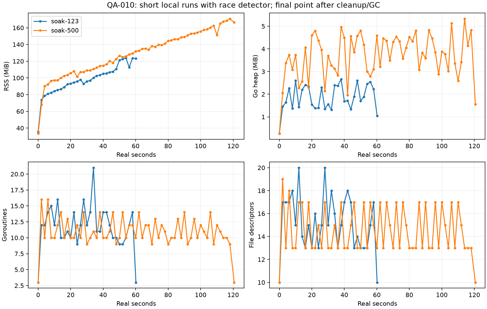
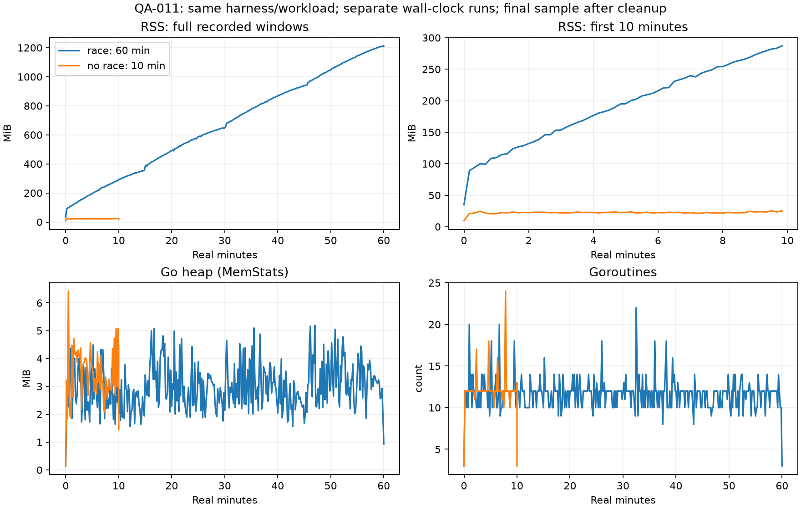

# Recursos, latência e baselines locais

Séries brutas em resources.jsonl; baseline e cleanup têm GC explícito, amostras intermediárias usam o GC normal. Nas tabelas QA-010, medições são do processo do harness instrumentado com race; a seção QA-011 distingue o controle sem race. CPU dos filhos reaped está separada. Coletas periódicas podem não capturar um pico de subprocesso curto.

## Baseline → pico amostrado → após cleanup

| Recurso | 123 / 60s | 500 / 120s |
|---|---|---|
| RSS bytes | 37.236.736 → 129.888.256 → 129.388.544 | 35.110.912 → 178.995.200 → 174.391.296 |
| Heap bytes | 279.504 → 2.794.192 → 1.099.592 | 278.728 → 5.586.672 → 1.634.584 |
| Goroutines | 3 → 21 → 3 | 3 → 16 → 3 |
| File descriptors | 10 → 20 → 10 | 10 → 19 → 10 |
| Filhos diretos | 0 → 2 → 0 | 0 → 2 → 0 |
| Threads | 8 → 15 → 15 | 8 → 14 → 14 |
| CPU própria acumulada, final | 41,210 s | 106,570 s |
| CPU filhos reaped acumulada, final | 9,792 s | 9,478 s |
| Tempo de cleanup | 158,35 ms | 622,16 ms |

FD/goroutines retornaram ao baseline; nenhum filho direto permaneceu. Threads retidas pelo runtime e RSS maior não são prova de vazamento. Heap de cleanup ainda inclui metadados/ledger/históricos referenciados pelo relatório, e a instrumentação race possui memória fora do heap reportado. Não foi feito perfil de retenção para atribuir quantitativamente o RSS a cada causa. **Tendência de vazamento sustentado permanece inconclusiva em uma janela de dois minutos**; executar horas, repouso e comparação de ciclos equivalentes antes de concluir estabilidade de memória.

Cache memory_bytes = null, propositalmente: não há contador público por cache; heap agregado não é apresentado como memória exclusiva do cache.

## Memória por guild — workload controlado separado

TestEnduranceGuildFootprint, três repetições sob race, 500 posições por guild, sem SQLite/decoder. Incremento de heap após GC dividido por guild:

| Guilds | Intervalo observado bytes/guild |
|---:|---:|
| 1 | 222.656–243.096 |
| 2 | 220.004–229.604 |
| 8 | 222.264–223.735 |

Medição de configuração inicial, não coeficiente universal de memória do bot completo. Não inclui FFmpeg, DAVE, HTTP, cache de metadados ou SQLite. Dados antes/carregado/depois estão em footprint.txt. Sem limites arbitrários derivados dessas três amostras.

## Latências locais

| Medida | Resultado observado | O que está incluído |
|---|---|---|
| ACK REST por TCP loopback | médias de benchmark 16,83–17,31 µs/op | SDK + limiter real gerenciado + HTTP local; sem Internet/Discord |
| Queue V2, 123 posições | 120,1–136,9 µs/op | construção de componentes, 14 mensagens; sem envio REST |
| Queue V2, 500 posições | 499,3–535,8 µs/op | construção de componentes, 56 mensagens; sem envio REST |
| Queue V2, 1.000 posições | 1,069–1,158 ms/op | construção de componentes, 112 mensagens; sem envio REST |
| Cache miss/resolução local, 123 | média 3,932 ms; máximo 5,255 ms | subprocesso controlado, não provedor externo |
| Cache hit, 123 | média 0,0152 ms; máximo 0,1030 ms | segundo Resolve imediato após priming; 492 hits |
| Cache miss/resolução local, 500 | média 5,432 ms; máximo 23,692 ms | 1.000 resoluções frias |
| Seleção→callback de início, 123 | média 114,44 ms; máximo 229,10 ms | campo histórico first_frame, inclui persistência antes do callback |
| Seleção→callback de início, 500 | média 434,12 ms; máximo 544,12 ms | mesma definição; não confundir com entrega exata de frame |
| Transição entre tentativas, 123 | média 148,62 ms; máximo 781,97 ms | inclui encerramento/persistência/agendamento/reabastecimento |
| Transição entre tentativas, 500 | média 615,63 ms; máximo 726,01 ms | inclui persistência/carga/instrumentação; atribuição exata não perfilada |
| Primeiro frame entregue, campanha final 1 guild | média 24,75 ms; máximo 25,77 ms | medido no transporte antes de OnStart/persistência de anúncio |
| Frame→callback de anúncio, mesma campanha | média 43,75 ms; máximo 46,01 ms | custo local após entrega; sem mensagem Discord real |

Médias/máximos extraídos de sumários; p50/p95/p99 do harness são limites superiores de buckets, não percentis exatos. Traces dos comandos guardam duração individual da API Go e erros esperados, não latência de slash commands pela rede. Há três repetições dos benchmarks (benchmarks.txt, ack-benchmark.txt), executadas em host compartilhado com outras verificações.

Nenhum SLA foi inventado. Para fixar budget: repetir baseline/candidato em runner dedicado e mesma imagem, alternar ordem, usar várias amostras/benchstat e investigar dispersão antes de bloquear release por números. Nesta etapa, gates rígidos são comportamentais (corrupção, deadlock, processo próprio restante, perda de identidade); performance permanece baseline observado. Latência de ACK e Queue reais de Discord segue pendente.

## QA-011 — uma hora real, com race

| Métrica | Baseline | Pico amostrado | Após cleanup/GC |
|---|---:|---:|---:|
| RSS bytes | 36.904.960 | 1.271.418.880 | 1.268.924.416 |
| Heap Go bytes | 153.128 | 5.441.752 | 978.464 |
| Goroutines | 3 | 22 | 3 |
| FD | 10 | 22 | 10 |
| Filhos diretos | 0 | 3 | 0 |
| Threads | 6 | 10 | 10 |

CPU própria acumulada: 1.541,36s; filhos reaped: 155,05s. CPU total da unidade systemd: 1.696,67s; memória de pico da unidade, incluindo filhos: 1.314.050.048 bytes. A unidade terminou exit=0, sem MainPID ativo. Houve 361 amostras; 359 periódicas e pontos baseline/cleanup.

RSS manteve inclinação positiva: 20,41MiB/min na janela inicial de dez minutos, 19,42 entre 10–30min, 18,17 entre 30–50min e 16,70 entre 50–60min. Nenhuma extrapolação foi contada como sessão executada. No final, o RSS estava cerca de 1,18GiB, enquanto o heap após GC era 0,93MiB. Isso é **crescimento sustentado observado**, não prova isolada de vazamento de objetos Go ou de produção. O gate operacional permanece bloqueado até atribuição/validação adequada.

A documentação primária do Go descreve memória adicional da instrumentação race, inclusive para defer/recover em goroutines de longa vida, que não aparece em ReadMemStats/pprof. Esse mecanismo é compatível com a divergência observada, mas não foi feita atribuição quantitativa aos call sites do Bardo. [Go: Runtime Overhead](https://go.dev/doc/articles/race_detector). O controle sem race concluiu 600,029s, com o mesmo harness/workload e limites. Dez minutos não demonstram estabilidade de uma hora sem instrumentação.

Médias por guild de entrega do primeiro frame: 57,90/58,13ms; callback após entrega: 323,55/330,70ms; transição: 489,59/482,13ms. Máximos de transição 5,50/5,65s incluem reabastecimento de lotes e restrição de CPU. Cache miss médio 8,33/8,38ms; hit médio 0,0392/0,0130ms. Histogramas continuam sendo limites superiores de buckets, não percentis exatos. Latência real de Discord continua não medida.

Não se repetiu qualquer modificação/refatoração de produção para reduzir o RSS do teste. Campanhas de 6h/12h com o mesmo binário race e envelope de 2GiB não serão liberadas com base apenas na hipótese de overhead. Ver evidence/qa011/1h-resource-review.json para as regressões lineares por janela e as séries brutas para auditar a análise.

### Controle concluído sem race

Nas amostras periódicas dos primeiros dez minutos, RSS com race: 89,02–287,06MiB, inclinação 20,41MiB/min; sem race: 20,66–25,11MiB, inclinação 0,109MiB/min. O controle terminou com RSS de 17,73MiB e heap de 1,45MiB após cleanup/GC. Goroutines 3→24→3, FD 10→27→10 e filhos 0→4→0. Selecionou 1.148 faixas em dez minutos, contra 3.900 na hora instrumentada: volume/duração não são idênticos, e não foi feita comparação sob throughput fixo. A associação com instrumentação é forte; atribuição quantitativa de toda a diferença e ausência de vazamento de produção permanecem não demonstradas. Não há correção de produção justificada por esses dados.

Dados comparativos e slopes em evidence/qa011/comparison.json. Próxima evidência para liberar campanhas longas: sessão comparável de uma hora sem race e triagem da retenção fora do heap antes de aumentar duração/limites. A QA-011 não eleva limites para presumir aprovação de 6h/12h.
