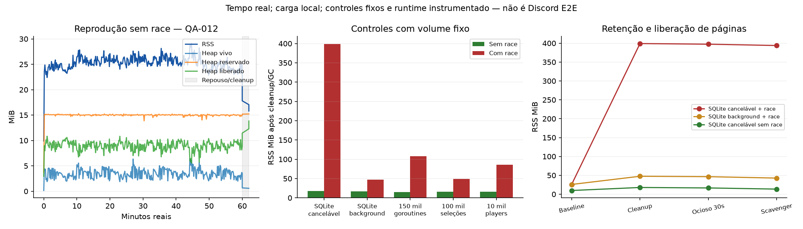

# QA-012 — investigação de RSS

Status: diagnóstico com controles concluídos e hora nativa concluída. Liberada **execução local protegida de 6h/12h sem race**; essas durações não foram executadas/aprovadas. Campanhas prolongadas com race no envelope atual seguem bloqueadas. Release/Discord real não homologados.

## Evidência de partida corrigida

O arquivo QA-011 `1h/20261020T022720.495383485Z/resources.jsonl` contém RSS final de **1.268.924.416 bytes (1.210,14 MiB; 1,18 GiB)**. O valor de 118 MiB mencionado na solicitação QA-012 é um erro de transcrição. Preservamos os dados originais. Heap Go final: 978.464 bytes, 3 goroutines, 10 FD, zero filhos diretos. Não havia smaps/pprof da hora QA-011: não se pode reconstruir retroativamente a atribuição exata daquele processo já encerrado.

A hora QA-011 tinha `-race`; o controle de dez minutos, não. Mesmo source baseline 27a49ba, fixtures, flags de carga, seed e limites; duração, número de seleções, horário e instrumentação diferentes. Controle: 1.148 seleções; hora: 3.900. Nenhum deles mede memória do bot conectado ao Discord.

## Método e isolamento

`cmd/qa-memory` reutiliza `internal/qasoak.Run` e o mesmo stand-in local. Não há listener HTTP/pprof, .env, tokens ou Discord. A única opção nova do harness é `Config.DisableCache`: fornece nil ao cache já opcional do resolver; não altera media/player/storage de produção. Retomada rejeita mudança de política de cache. Quando cache é desativado, usar `-warm=false` para não rotular uma segunda resolução fria como cache hit.

Diretórios novos sob `.qa-runs/qa012/`, excluídos de Git/Docker, SQLite exclusivo de QA. Perfis/JSON/procfs e relatórios exportados não incluem o banco. Serviços próprios limitados a 2GiB, sem swap, um núcleo por unidade, nice 10, CPU/IOWeight 10, TasksMax 128, NOFILE 256, arquivo individual 512MiB, NoNewPrivileges e somente sockets AF_UNIX. Até três unidades de investigação podem coexistir; host compartilhado de oito CPUs. Não interpretar tempo/CPU como benchmark dedicado ou estritamente pareado com QA-011.

Ambiente dos executáveis: PATH=/usr/bin:/bin, GOMAXPROCS=2, GOMEMLIMIT=256MiB e, para race, GORACE=atexit_sleep_ms=0. Perfis de heap/allocs com MemProfileRate=64KiB; não confundir estimates amostrados de pprof com contadores exatos de ReadMemStats. O profiler adiciona buffers e metadados: baselines separados com e sem race quantificam parte desse custo. MemStats é lido antes das alocações da própria coleta; smaps detalhado é lido depois de escrever os perfis. As duas medidas não são um snapshot atômico.

O ponto de cleanup do harness é anterior ao retorno de Run e ainda retém o ledger/estado do relatório. O cleanup do wrapper é posterior ao retorno e pode ter heap menor; os dois são preservados e não são tratados como a mesma fase.

Cada execução grava baseline após GC, amostras a cada 10s durante carga, cleanup/GC, período ocioso real, GC e `debug.FreeOSMemory`. Forçar o scavenger é **experimento diagnóstico**, não correção nem política nova de produção. HeapAlloc é alocação viva, HeapInuse inclui spans ocupados, HeapSys é reserva do heap, HeapIdle/HeapReleased distinguem páginas ociosas/liberadas. `Sys` e runtime/metrics também são preservados. Smaps separa reserva virtual de RSS; memória de FFmpeg/stand-in não compõe RSS do pai. O harness registra filhos diretos/CPU reaped separadamente.

## Reprodução

```sh
go build -o .qa-runs/qa012/memory ./cmd/qa-memory
go build -race -o .qa-runs/qa012/memory-race ./cmd/qa-memory
# Executar em escopo de QA com os limites acima e diretório inexistente:
.qa-runs/qa012/memory -out .qa-runs/qa012/nova-hora -duration 1h -idle 120s
python3 -B scripts/qa012_matrix.py --out .qa-runs/qa012/nova-matriz \
  --native .qa-runs/qa012/memory --race .qa-runs/qa012/memory-race
python3 -B scripts/qa012_matrix.py --isolate --out .qa-runs/qa012/novos-isolamentos \
  --native .qa-runs/qa012/memory --race .qa-runs/qa012/memory-race
python3 -B scripts/qa012_analyze.py --run .qa-runs/qa012 --out /tmp/qa012-analysis.json
```

O wrapper usa a mesma função Source, mas retorna exit 1 para a falha controlada de fonte; o CLI qa-soak original retorna 7. Ambos são não zero e o mesmo oráculo os classifica como unavailable sem frames. Essa diferença de CLI não existe nos controles exclusivamente SQLite/goroutines e não explica o diferencial de memória ali reproduzido.

Matriz: baseline sem reprodução (60s); cache quente, frio e desativado (180s por caso); 100.000 seleções simuladas em um player; 10.000 ciclos de criação/encerramento. Cada caso recebe 30s de repouso após cleanup. Os controles simulados exercitam player e identidade/ordem, sem SQLite, resolver ou subprocessos; não representam áudio real, nem duração equivalente a soak.

Isolamentos: 300 SaveGuild com a mesma fila de 500 identidades, carregada e conferida após as escritas; cinco milhões de chamadas simples versus com defer, com barreira antes/depois de terminar a goroutine. Cada experimento fixo roda com e sem race: volume idêntico, duração medida. Reproducer mínimo de defer caracteriza mecanismo do runtime; não atribui automaticamente o RSS do Bardo a esse mecanismo.

O toolchain instalado não distribui o binário pprof. Compilamos a ferramenta oficial já presente em `/usr/lib/go/src/cmd/pprof`, sem dependências novas no projeto. `GORACE=profile_memory=...` foi experimentado em probe local e não produziu arquivo: no código LLVM usado pelo Go, inicialização desse profiler/background thread é excluída em SANITIZER_GO. Essa tentativa é registrada como sem dados, nunca como perfil coletado.

Os controles não alteram history_size nem suprimem reports do race detector. O contexto background é limitado ao experimento: desativar cancelamentos em produção não é correção aceitável para custo de instrumentação.

## Fontes de interpretação

- [Go race detector, runtime overhead](https://go.dev/doc/articles/race_detector): instrumentação tem memória adicional fora de MemStats/pprof, inclusive para defer/recover.
- [LLVM tsan_rtl.cpp, revisão do README runtime/race instalado](https://github.com/llvm/llvm-project/blob/51bfeff0e4b0757ff773da6882f4d538996c9b04/compiler-rt/lib/tsan/rtl/tsan_rtl.cpp): inicialização do profiler e memória de rastreamento.
- [LLVM tsan_platform.h, mesma revisão](https://github.com/llvm/llvm-project/blob/51bfeff0e4b0757ff773da6882f4d538996c9b04/compiler-rt/lib/tsan/rtl/tsan_platform.h): faixas shadow e metainfo de MappingGo48. Classificar somente mapeamentos compatíveis; anonymous residual não é automaticamente todo sanitizer.
- `evidence/qa012/memstats-reference.txt` e `scavenger-reference.txt`: documentação do toolchain efetivamente usado, Go 1.27.1-X:nodwarf5.

## Controles concluídos

21 controles concluídos, todos exit=0; além da hora, há duas probes auxiliares de flags TSan (help/profile_memory) preservadas em auxiliary, não contadas como campanhas de playback; não confundir controles de operações fixas com horas de soak. As durações reais e comandos estão em `evidence/qa012/{matrix,isolate,context}-execution.jsonl`. O wrapper inclui 30s ociosos nos tempos desses manifestos; reprodução usa exatamente o período solicitado no summary do harness.

| Controle | RSS após cleanup/GC sem race | Com race | Volume |
|---|---:|---:|---|
| Baseline sem reprodução | 12,68 MiB | 35,20 MiB | 60s reais + repouso |
| Cache quente | 18,00 MiB | 151,77 MiB | 180s reais; throughput diferente |
| Cache frio | 20,03 MiB | não executado nesse modo | 180s reais |
| Cache desativado | 20,17 MiB | 143,41 MiB | 180s reais; warm=false |
| Player sem SQLite/subprocessos | 15,91 MiB | 48,75 MiB | 100.000 seleções verificadas |
| Ciclos de player | 15,96 MiB | 85,68 MiB | 10.000 ciclos; uma instância inicial e uma final vazia |
| SQLite cancelável | 17,84 MiB | 399,03 MiB | mesmas 300 escritas, fila fixa de 500 identidades |
| SQLite não cancelável, diagnóstico | 17,02 MiB | 47,54 MiB | mesmas 300 escritas, mesmas identidades |
| Goroutines curtas | 15,30 MiB | 107,59 MiB | 150.000 criações com barreira de término |
| Chamadas simples/com defer vazio | aproximadamente 14 MiB | aproximadamente 36 MiB | 5 milhões por caso, sem crescimento relevante atribuído a defer |

Números arredondados para leitura; fonte exata é `analysis.json`. Cache frio e desativado são próximos sem race. Não usar cache quente versus desativado como isolamento perfeito do cache: o primeiro faz uma segunda resolução/hit, e o throughput difere. Os experimentos fixos SQLite são o controle forte de volume.

O driver modernc/sqlite 1.39.1 (`sqlite.go`, interruptOnDone) cria uma goroutine curta por chamada com Done não nil, encerrada pelo donech no retorno. No controle cancelável foram 151.236 goroutines criadas cumulativamente; no background, 334 (valores absolutos no ponto de cleanup; há baseline do runtime). Ambos retornaram a 3 goroutines de aplicação após cleanup. Sem race, RSS fica próximo nos dois casos; com race, o diferencial é aproximadamente 351,5 MiB. O controle sem SQLite de 150 mil goroutines reproduz parte da retenção, enquanto 100 mil seleções em um único player retêm muito menos. Isso isola custo de instrumentação associado a churn/lifecycle de goroutines, não goroutines de aplicação sobreviventes ao encerramento.

O SQLite com race permaneceu em aproximadamente 397 MiB após repouso e 394 MiB após scavenger, apesar de HeapSys aproximadamente 7,3 MiB, Sys aproximadamente 12,6 MiB e heap vivo abaixo de 0,3 MiB. Os smaps registram páginas **residentes** anônimas fora das regiões Go nomeadas e shadow/metainfo da instrumentação. Não se trata somente de reserva virtual. Não atribuímos cada bloco anonymous ao sanitizer sem stacks de alocação nativa: a inferência causal vem da troca de instrumentação e contexto com carga fixa, junto com esses mapas.

Perfis de alocação apontam SaveGuild, serialização JSON, clonagem do estado da fila e interrupção de queries como principais fontes de alocação. Exemplo: SaveGuild concentra 81% cumulativos do alloc_space no controle warm-race e 99% no controle exclusivamente SQLite; essas porcentagens amostradas **não** são retenção de RSS. O perfil inuse_space após GC é pequeno. Foram preservados perfis brutos, tops e contadores exatos; não há justificativa para refatorar persistência apenas por esse volume de alocação.

O reproducer de defer vazio foi **negativo**: não reproduziu a grande retenção nesse compilador. A documentação do Go sobre defer/recover não prova que esse seja o call site responsável no Bardo. O profiler interno profile_memory não gerou evidência na probe e não é usado para afirmar atribuição.

## Classificação das hipóteses

| Hipótese | Evidência e limite |
|---|---|
| Vazamento de objetos Go | Não confirmado. Perfis inuse e heap pós-GC pequenos; isso isoladamente não elimina leaks fora do heap. A série RSS nativa prolongada será avaliada separadamente. |
| Cache sem limite | SearchCache tem limite de 256 entradas e TTL de dez minutos; controles frio/desativado próximos e crescimento ainda presente com race sem cache. Não identificado como causa dominante. |
| Retenção legítima/runtime | HeapSys, HeapIdle e HeapReleased são preservados. Scavenger reduz algumas páginas Go; profiler/runtime/metadados e páginas do executável compõem parte do residual nativo. |
| Reserva virtual/mapeamentos | Smaps registra Size e Rss separadamente. A grande reserva shadow/metainfo não é contabilizada como RSS; há também páginas residentes anônimas no caso race. |
| Instrumentação | Reprodução com carga fixa e troca de contexto demonstra grande efeito do race ligado ao churn. Goroutines de aplicação encerram; RSS externo ao heap permanece. Não há atribuição byte a byte da hora QA-011, pois faltam seus smaps. |
| Fragmentação/alocador nativo | Pode compor anonymous residual do binário instrumentado; não distinguimos cada bloco interno entre trace, metadata e páginas livres retidas. Não chamar toda essa memória de vazamento ou de shadow. |
| Buffers/subprocessos | Reprodução em SQLite/goroutines sem FFmpeg/yt-dlp demonstra que subprocessos não são necessários para o fenômeno. RSS do pai não inclui RSS dos filhos. |
| Artefato do harness/profiler | Baseline de instrumentação e buffers de perfil medidos separadamente; carga de snapshots de filas de 500 intensifica SaveGuild e goroutines. O workload é adversarial, não músicas naturais de três minutos. |
| Ambiente/carga | Mesmos toolchain e fontes de produção; flags, quota, amostragem e volumes registrados. Duração/throughput/horário diferem entre soaks; comparações fortes usam operações fixas. Host compartilhado impede inferir SLA. |

Sem alteração de produção proposta. Otimizar snapshots/queries ou remover acompanhamento de contexto sem defeito comportamental reproduzido excederia esta investigação.

## Campanha prolongada sem race

Executada de 2026-10-20T08:45:22Z até 09:45:22Z, mais 120s de repouso real; wrapper terminou aproximadamente 09:47:22Z. Reprodução: **3.600,017542178s**. Diagnóstico incluindo repouso/perfis: **3.720,052529182s**. Cleanup do harness: 11,24ms. SQLite, local WAV de 1s, FFmpeg/libopus real, duas guilds, cache quente, fault placement seed 20261019 e playlist 500, como a QA-011. Foram 14 batches aceitos; seis lotes completos drenados por guild, sétimo parcial.

7.000 posições aceitas = 6.874 selecionadas + 126 pendentes. Terminais: 6.146 completed, 246 unavailable, 480 error_interrupted e 2 shutdown_interrupted. Anúncios: 6.628, todos vinculados a frames aceitos; frames: 345.626. Transições: 6.872. Ledger do exportador existente aprovado, sem duplicação indevida, corrupção, seleção sem terminal ou perda silenciosa detectada. Falhas locais classificadas não impediram o avanço. Não representa identidade do áudio de provedores: todas as identidades lógicas usam a mesma fixture WAV local.

| Recurso do harness | Baseline | Pico amostrado | Cleanup |
|---|---:|---:|---:|
| RSS | 12,16 MiB | 29,08 MiB | 18,82 MiB |
| Heap Go | 223.808 bytes | 6.556.064 bytes | 1.360.816 bytes |
| Goroutines de aplicação | 4 | 354 | 4 |
| FD | 11 | 32 | 11 |
| Filhos diretos | 0 | 4 | 0 |
| Threads | 7 | 11 | 11 |

O pico transitório de goroutines foi coletado no workload de persistência; não permaneceu após cleanup. Threads do runtime retidas não são classificadas como leak. No wrapper, após Run retornar: 3 goroutines, igual ao baseline. Contador cumulativo de goroutines criadas: 7.372.471; aproximadamente 46,3GB de TotalAlloc e 21.373 GCs até cleanup. Não confundir churn/alocações cumulativas com retenção. Pausas GC cumulativas até cleanup: aproximadamente 1,10s; GCCPUFraction aproximadamente 0,00113. Perfil e contadores não apontam GC incapaz de acompanhar o workload.

| Fase do wrapper | RSS | Heap vivo | HeapSys | HeapReleased |
|---|---:|---:|---:|---:|
| Após retorno/GC | 17,81 MiB | 0,664 MiB | 15,188 MiB | 11,453 MiB |
| Após 120s ociosos/GC | 17,05 MiB | 0,583 MiB | 15,219 MiB | 12,297 MiB |
| Após FreeOSMemory | 15,80 MiB | 0,583 MiB | 15,219 MiB | 13,828 MiB |

RSS periódico ficou entre 22,40–29,08MiB. Slopes OLS: 0–10min +0,07465MiB/min; 10–30min -0,00036; 30–50min -0,01704; 50–60min -0,05680. Não há a tendência sustentada de 16–20MiB/min da hora com race. Há aquecimento inicial, oscilação e liberação após cleanup/repouso/scavenger; a conclusão não se baseia apenas em heap baixo. Nenhum threshold universal foi inventado.

CPU do pai 124,04s; filhos reaped 252,90s. CPU da unidade completa incluindo diagnóstico/repouso: 377,38s; pico de memória da unidade incluindo filhos: 78.917.632 bytes. O serviço encerrou; suas estatísticas históricas vêm do journal filtrado, não dos valores default de uma unidade já descarregada.

Latências locais médias: cache hit 0,0042ms; miss 3,120ms; entrega do primeiro frame 39,35ms; anúncio após frame 11,06ms; transição 18,86ms (máximo 1.850,11ms inclui refill). Sem latência de rede ou ACK Discord. Artefatos, perfis e banco/checkpoint preservados; somente hashes do SQLite foram exportados.



## Decisão operacional e pendências

A evidência permite **liberar a execução opt-in de 6h/12h locais sem race**, mantendo os mesmos limites de recursos/isolamento, coleta e oráculos. Isso libera o experimento; não aprova as durações ainda não executadas. A hora nativa exerceu 6.874 seleções contra 3.900 da hora instrumentada; os controles de volume fixo também isolam o efeito, embora os soaks não sejam benchmarks pareados.

O crescimento com race permanece real no executável instrumentado e pode exceder seu envelope em sessões maiores. Não liberar 6h/12h com race sob 2GiB nem suprimir detecção para obter PASS. Race detector continua obrigatório na suíte e nos controles curtos. Atribuição de todos os blocos anonymous do sanitizer ainda não é byte a byte; não há correção de produção ou dependência justificada, nem garantia sobre DAVE/Discord nativos não exercitados.

As campanhas de 6h/12h continuam **não iniciadas**, não interrompidas ou aprovadas. Nenhuma campanha desta investigação foi interrompida. Discord real, memória de DAVE/conexões reais, toolchain/security gate e demais bloqueios anteriores permanecem pendentes. Não declarar a release pronta ou toda a QA encerrada pela conclusão desta triagem local.


## Validação e ocorrências de desenvolvimento

`go test ./... -count=1` (24,52s), `go test -race ./... -count=1` (36,62s), `go vet ./...` (0,07s): exit=0 em todos, logs e timestamps em evidence/qa012/validation.json. Não houve race report ou falha de teste comportamental nessas execuções. Uma compilação intermediária do novo teste de configuração falhou por import os ausente; o import foi acrescentado, testes afetados repetidos e as três verificações completas finais passaram. Não se trata de defeito de produção ou teste flaky escondido.

As tentativas de invocar `go tool pprof` e compilar `cmd/pprof` a partir da raiz do módulo falharam por ferramenta ausente/resolução de std; a compilação no diretório do código Go exigiu autorização para o cache de build. O analisador oficial foi então compilado localmente, sem alterar go.mod/go.sum. Esses incidentes de ambiente não são falhas do Bardo.

Regressões permanentes: identidade/ordem e encerramento dos controles simulados, contexto previamente cancelado sem seleções, persistência de fila fixa no controle SQLite, incompatibilidade de cache em retomada e rejeição de métricas warm quando cache está desligado. Nenhuma mudança em player, streaming, media, storage ou dependências de produção.


## Integridade dos artefatos e commits

`profile-index.json` contém SHA256 do conteúdo original e exportado; JSONL/smaps são gzip determinístico, perfis pprof preservados em formato nativo. `analysis.json` inclui também as duas probes auxiliares, identificadas pelo caminho. `verification.json` separa 22 campanhas/controles concluídos dessas probes. `native-hour-review.json` agrega ledger, fases, GC, latências e hashes de checkpoints. SQLite não exportado; originais e executáveis permanecem em `.qa-runs/qa012/`.

Não restaram processos dos executáveis QA-012. Todos os PIDs de filhos amostrados na hora foram conferidos após encerramento, sem sobreviventes; essa observação complementa filho direto zero no cleanup, sem pretender inventário de todos os processos do host. Unidades systemd transitórias encerraram e foram descarregadas automaticamente. O arquivo native-active-limits.txt contém limites efetivos enquanto a hora rodava; o journal filtrado contém consumo final. Não interpretar valores default de unidades descarregadas como limites históricos.

70b8184 registra ferramenta e regressões; relatório/evidências registrados em commit separado. Não houve refatoração ou mudança de comportamento de produção. Atribuição interna fina da memória instrumentada permanece limitação explícita, e a liberação local de execução não encerra todos os gates de QA/release.
