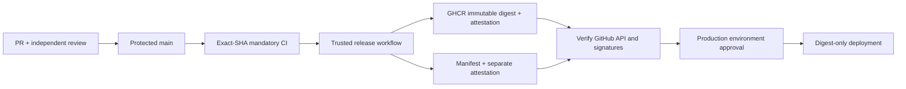

# REL-028 — GitHub-verified production releases

Audit date: 2026-10-31. Repository: `ghptc/whiterun-music-bot`.
Production was inspected read-only. No deployment, restart, playback request,
database mutation or network change was performed.

## Findings and discrepancies

| Item | Observed evidence |
| --- | --- |
| Original local HEAD | `62a44ef2a7559318931af18eeabc1c21debb1f0f` |
| Fetched `origin/main` | `4598f4904b4f8b2ff5f03d5cec12133c8c82c357` |
| Local divergence | Eleven commits ahead, including DB-022, REL-024, FIX-025, provider recovery, local audio, OPT-026 and YT-027 |
| OPT-026 | `d6ddec304c64c6a1170fda9e118061a0ead8814d`: absent from remote commit API; zero GitHub workflow runs for this SHA |
| YT-027 | `62a44ef2a7559318931af18eeabc1c21debb1f0f`: absent from remote commit API; zero GitHub workflow runs for this SHA |
| Production revision | `d6ddec304c64c6a1170fda9e118061a0ead8814d` |
| Production image ID | `sha256:cfb1a0bffc7d59f04945feb0029d4530e66f16c3df3d1b647e37d3e0c7a62bbd` |
| Production container | `d9f5fc098976e36b6267158467540c8b597bdaee15b13db4d91bd8d1cd30417b` |
| Production process | Running; restart count zero; started `2026-10-31T02:26:51.11063459Z` |

**The running OPT-026 image is a legacy unverified release.** Its local image ID
and revision label do not establish GitHub provenance. Existing successful local
tests and the YT-027 candidate image on EC2 do not authorize production deployment.
Neither pending SHA was merged into remote `main` at audit time.

Work was isolated in `/tmp/bard-rel028`, branch
`rel028/github-verified-releases`, based on the existing local HEAD. All unrelated
dirty files and untracked incident evidence in the original checkout were left
untouched. The PR necessarily includes the eleven unmerged prerequisite commits;
review that entire pending stack before merging. Do not merge without approval.

## GitHub protection

Before this change, active ruleset `main` (ID `23219764`) covered the default
branch, disallowed deletion and force pushes, required PRs and code-quality
analysis, but required **zero approvals and no status checks**. The classic
branch-protection endpoint returned 404; the branch was nevertheless protected
by that ruleset. Existing `Quality` and performance workflows were advisory.

The original ruleset remains unchanged. An additional active ruleset,
[`REL-028 verified releases`](https://github.com/ghptc/whiterun-music-bot/rules/26275718),
ID `26275718`, applies exactly to `refs/heads/main`, with no bypass actors:

- Strict, up-to-date required checks bound to GitHub Actions application ID `15368`.
- One independent PR approval, stale-review dismissal, approval of the latest
  push, and resolution of review threads.
- No branch deletion or force pushes.

The six required contexts are:

| Context | Mandatory validation |
| --- | --- |
| `release-unit` | `go vet ./...`, full uncached Go suite, release-policy unit tests |
| `release-race` | Race detector: media, player, discord, storage |
| `release-contracts` | OPT-026 identity/recovery, REL-024, FIX-025, DB-022 real SQLite/quota/retention/alert tests |
| `release-security` | `go mod verify`, pinned `govulncheck@v1.9.0` |
| `release-docker` | Build existing Dockerfile; no publication or deployment |
| `release-ci` | Always-run gate; all five prerequisite jobs must succeed |

No path filters permit bypassing these jobs. Pending, failed, cancelled or skipped
checks are rejected. Existing code-quality and other original rules still apply.
The PR author cannot provide their own required PR approval; another authorized
reviewer is needed. Do not lower the approval requirement to unblock merging.

The new `production` GitHub environment requires review by `ghptc`, permits only
protected branches, and disables administrator bypass. Self-review is allowed
for explicit owner approval of a deployment; it does not replace independent PR
review. No SSH credentials or production destination variables were provisioned.

## Trusted artifact chain



`.github/workflows/release.yml` runs after successful `Release CI` on a push to
`main`, or by an explicit dispatch on `main`. It checks GitHub again rather than
trusting the trigger's conclusion. Only the current protected-main tip can be
published, keeping the workflow/OIDC source SHA identical to the build SHA. If
main advances during a release, the gate fails; publish the new tip after its CI.

It checks out the exact clean commit, builds the existing Dockerfile, publishes
to GHCR, and records its immutable digest. A unique SHA/run/attempt tag supports
discovery; deployments never use that tag. No `latest` is generated. Actions in
the trusted chain are pinned to complete commit SHAs, with checkout credential
persistence disabled. Builds and attestations use GitHub-hosted runners.

Both the image and `release-manifest.json` receive GitHub/Sigstore build
attestations from the pinned source revision of `release.yml`. The manifest
contains repository, source ref, commit, digest, release run/attempt/workflow,
CI run/attempt and required check/job IDs. Its artifact name binds the release
run and attempt, with 90-day retention. Labels alone are never trusted.

## Fail-closed deployment verification

`scripts/releases/deploy_production.py` is the supported production entrypoint,
called only by `.github/workflows/deploy-production.yml`. Before any SSH it:

1. Checks protected-main reachability, effective required checks and the
   dedicated active non-bypassable ruleset.
2. Verifies the newest exact-SHA protected-main push CI run, trusted workflow ID,
   repository, hosted jobs and successful checks. Job check IDs must agree with
   GitHub's exact-SHA check records. Additional required status checks must pass.
3. Downloads the exact nonexpired manifest artifact from a successful trusted
   release run; rejects ambiguous, oversized or unexpected archive contents.
4. Cryptographically verifies the manifest and OCI image with `gh attestation
   verify`: repository, signer workflow, signer SHA, source SHA, main ref, hosted
   runner and exact release run/attempt. Checks manifest contents against live
   GitHub evidence and requires the approved GHCR repository plus `sha256` digest.
5. Verifies a **separate previously verified rollback artifact** the same way.
6. Requires a fresh active main deployment run, exact approved input summary,
   protected `production` environment without admin bypass, and approved review
   history from an allowed reviewer. Re-running an old deployment attempt is
   rejected; dispatch a fresh run for fresh approval.
7. Pulls both immutable images on the runner and checks their revision labels
   after signature verification. Uses a separately provisioned SSH identity and
   pinned host key, never trust-on-first-use host discovery.

Any unavailable API, attestation, check, manifest or approval denies deployment.
There is no offline or skip-verification flag. Shell environment flags alone do
not substitute for GitHub run and approval evidence.

The remote apply template pins the existing Bard service/project/volume paths,
refuses a changed current image or a busy persisted queue/current track, checks
disk headroom, and backs up both SQLite databases using SQLite's online backup
API with `quick_check`. Before replacement it stops only Bard and creates a
consistent full-volume archive outside the service path. Configuration, secrets,
prior image evidence and backup checksums remain private on EC2.

Compose raw content changes only at its existing image line. The entrypoint
uses `up --no-deps --no-build --pull never bard`, preserving volumes, environment,
restart, healthcheck, security and resource settings. It checks Docker health,
Gateway, responsive workers, SQLite, recovery readiness, persistent table hashes,
restart count and other containers' start times. It never executes playback.

Operational failure triggers only the separately verified rollback digest.
It never restores databases automatically, reverses migrations, prunes images,
deletes volumes or performs `down -v`. A schema incompatibility or changed data
requires human analysis. The healthcheck stays unchanged; provider availability
is not proof of internal failure or restored YouTube playback.

## Tests and security finding

Local validation is evidence for review, **not GitHub release authorization**.
Recorded logs are in `evidence-rel028/`.

- Release verifier: 12 test methods, including 27 negative release cases, passed.
  Cases reject feature branches, unmerged commits, unprotected/bypassable main,
  failed/pending/cancelled/skipped CI, wrong SHA/check source, spoofed check names,
  self-hosted runners, missing/expired manifest, tampered metadata, wrong digest,
  mutable tags, local images, foreign/untrusted runs and archive traversal.
- Additional tests exercise valid verified release/deployment authorization,
  latest-failure rejection, signed wrong digest, missing attestations, exact
  attestation run binding, explicit legacy migration, verified rollback, fresh
  approval, and proof that denied authorization never reaches remote apply.
  Build and deployment checkouts must be clean and at the exact workflow SHA;
  modified tracked inputs and untracked inputs are both rejected.
- Full Go suite, vet, affected-package race detector, identity/recovery contracts,
  SQLite/quota contracts and Docker build passed before the security correction.
- The initial required security scan detected reachable `GO-2026-6860` in
  `golang.org/x/net v0.56.0`, through `internal/media/spotify_embed.go` calling
  `html.Parse`. It was not suppressed: update to fixed `v0.62.0`, with Go's required
  companion module updates (`x/text`, `x/crypto`, `x/sys`). See final validation
  evidence for the corrected dependency graph.
- `actionlint v1.7.11` accepted all three new workflows.
- After the dependency correction, the full Go suite, vet, race detector, Docker
  build and module verification passed again. `govulncheck` exited zero with no
  reachable vulnerabilities (two findings remain in required modules outside
  the reachable/imported packages). The identity corpus passed all 14 positives
  and 31 negatives, with zero false positives; provider and SQLite contracts passed.

GitHub PR checks and the first main release must still be observed independently.
A local Docker image tagged `bard-rel028:ci-only` is explicitly ineligible for
production. No claim is made that a real attested release or production rollback
has already been executed.

### First GitHub run: discrepancy caught and corrected

The first PR run [`41218991532`](https://github.com/ghptc/whiterun-music-bot/actions/runs/41218991532)
passed unit, race, contracts and Docker, but correctly failed security and the
aggregate gate. `setup-go` selected the module's old minimum `go 1.27.0`, while
the local toolchain was `go1.27.3-X:nodwarf5`. GitHub found nine reachable standard
library vulnerabilities, requiring Go 1.27.2 or 1.27.3, including `GO-2026-6809`.
This demonstrates why local green results cannot authorize a release. The
module minimum and Docker builder are now explicitly `1.27.3`; no findings were
ignored and no check was removed. See `github-first-security-failure.txt` and
the subsequent exact-head GitHub run for verification of this correction.

### GitHub verification and outstanding older failures

All six mandatory jobs passed in PR run
[`41220692136`](https://github.com/ghptc/whiterun-music-bot/actions/runs/41220692136)
for exact feature SHA `e253a1e010c29e048ec91b56c984c493dcea36d7`. This is PR CI,
not qualifying protected-main push CI or release provenance. The PR is
[#1](https://github.com/ghptc/whiterun-music-bot/pull/1); it remains unmerged and
blocked by review. Documentation updates after this SHA require their own checks.

Two failures in existing advisory workflows must remain visible:

- `Instant playback performance gate`, run `41219779468`: transition test failed
  with `ready EOF transition stalled`; consequently the evaluator correctly
  reported the missing ready-transition scenario. A single isolated run of
  `BARD_INSTANT_GATE=1 BARD_GATE_SAMPLES=100 go test ./internal/discord -run
  '^TestInstantPlaybackTransitionGate$' -count=1 -v -timeout=3m` against the original
  `62a44ef` reproduced the exact failure at line 617 after 8.10 seconds. Its source
  is unchanged by REL-028. This is a confirmed failure already present in the
  pending application stack, not a passing performance result.
- `Quality`, run `41219779441`: full-package race job hit the existing 3-second
  logstore close deadline in `TestConcurrentWritesBatchAndFinalFlush`. Twenty
  targeted baseline race iterations passed; therefore the original CI timeout is
  recorded, but its cause and baseline reproducibility remain unconfirmed. No
  timeout was raised, no test skipped, and no rerun was used to erase this result.

These workflows were not required before this audit and were not disabled or
weakened. Mandatory REL-028 validation does not certify these additional
performance properties. Investigate the application-stack failures before
approving its merge or production migration; REL-028 does not fix the playback
transition or logging implementation. See the preserved logs and baseline results.

## Migration and operation

1. Review the complete pending stack through the feature PR, including YT-027.
   Require successful GitHub PR checks and independent review; obtain approval
   before merge. Squash/rebase changes the resulting SHA: authorize only the
   resulting main commit and its new main push CI, not the old local SHA.
2. After merge, observe exact-SHA main CI, then a successful Verified Release.
   Read its `release-manifest-<run>-<attempt>` artifact. Verify without deployment:

   ```sh
   python3 scripts/releases/verified_release.py verify --release-run <release-run-id>
   ```

3. Prepare a second independently verified release run for rollback (a separate
   successful dispatch of the same main revision can provide a verified recovery
   artifact, but does not prove older application behavior). No unverified legacy
   image may serve as automatic rollback. Review migration/schema compatibility.
4. Provision `PRODUCTION_SSH_KEY` as an environment secret and `PRODUCTION_HOST`,
   `PRODUCTION_USER`, `PRODUCTION_HOST_KEY` as environment variables through a
   separately authorized operation. Confirm remote GHCR read access and the
   fixed service/volume paths. No credentials were copied from local SSH.
5. Obtain production authorization for a maintenance window and idle guild
   state. Dispatch Verified Production Deployment **on main** with approved
   release run, separately verified rollback run and immutable expected current.
   The first migration additionally requires `allow_legacy_current=true` and
   the exact audited legacy image ID. The owner must approve these exact inputs
   in the protected production environment. This report does not authorize that
   migration.
6. Inspect remote private backup/result records and operational checks. Request
   a manual Discord audio test separately; no real-audio success is inferred.

## Remaining risks and boundaries

- Rules are active now; new workflow/verifier code becomes authoritative on main
  only after approved merge. Until then production releases are blocked by this
  policy. The eleven old commits have no qualifying main GitHub checks.
- No verified rollback artifact exists yet. First migration remains blocked until
  both artifacts, CI, signatures, environment configuration and approval exist.
- Retention/registry deletion, unavailable GitHub/Sigstore APIs, changed required
  checks or rerun check IDs can invalidate old releases and rollback evidence.
  Renew verified artifacts before expiry; fail closed rather than reuse stale
  evidence. No permanent registry-retention guarantee was configured.
- Security scanning covers reachable Go vulnerabilities and module checksums;
  it does not certify Debian/FFmpeg/yt-dlp or licensing. Base-image dependencies
  are resolved by the existing Dockerfile; digest identity and attestations
  prove the built artifact, not reproducibility or absence of all vulnerabilities.
- A repository administrator can edit rules/workflows; a host root operator can
  bypass repository tooling. This policy enforces the supported deployment path,
  not protection against compromised administrative credentials. Dedicated SSH
  credentials should be narrowly scoped; hardening host authorization needs a
  separate infrastructure approval. No host enforcement was silently installed.
- No live deployment fault injection was performed. Backup/health/rollback logic
  requires an approved operational rehearsal before relying on it in an incident.
- YouTube access remains externally unresolved. Release integrity changes do not
  establish provider access or real Discord audio playback.

## Official contracts used

- [GitHub artifact attestations](https://docs.github.com/en/actions/how-tos/secure-your-work/use-artifact-attestations/use-artifact-attestations)
- [GitHub CLI attestation verifier](https://cli.github.com/manual/gh_attestation_verify)
- [GitHub rules API](https://docs.github.com/en/rest/repos/rules)
- [Workflow review history API](https://docs.github.com/en/rest/actions/workflow-runs#get-the-review-history-for-a-workflow-run)
- [GitHub SLSA predicate implementation](https://github.com/actions/toolkit/blob/main/packages/attest/src/provenance.ts)
- [Go vulnerability GO-2026-6860](https://pkg.go.dev/vuln/GO-2026-6860)
